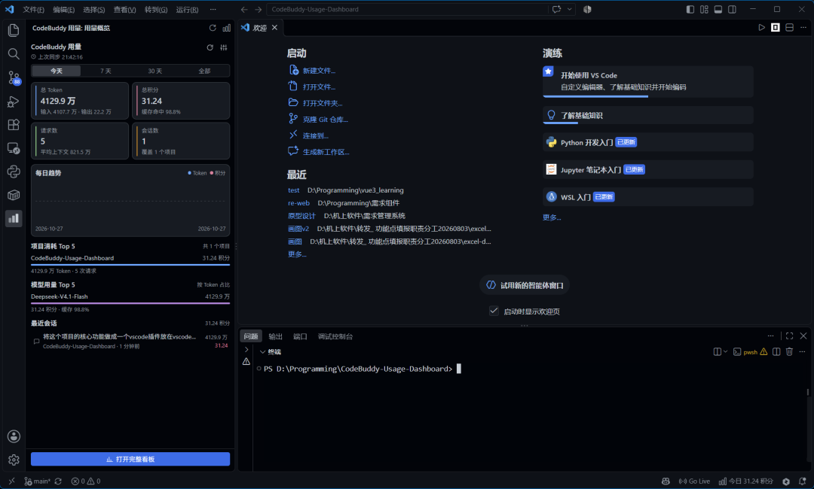
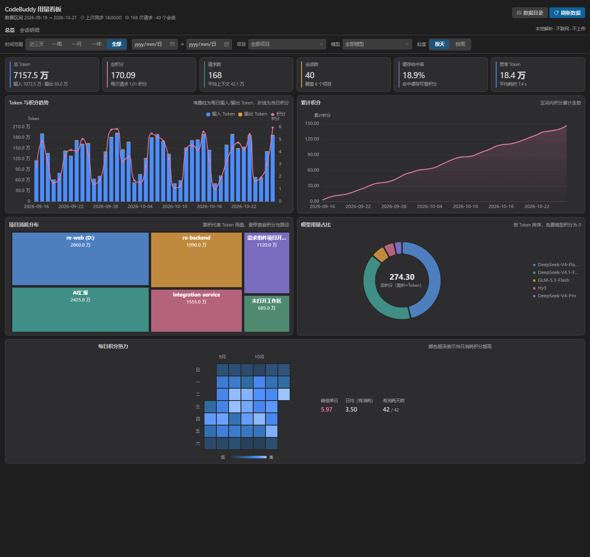
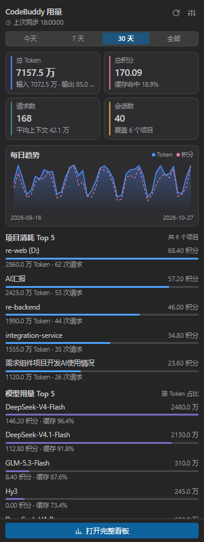

# CodeBuddy / WorkBuddy 用量看板 · VSCode 扩展

在 VSCode 侧边栏直接查看本机 CodeBuddy 与 WorkBuddy 的 Token 与积分消耗：每日趋势、项目与模型分布、会话与逐请求明细。
看板与侧边栏顶部有数据源开关，可在两个产品之间一键切换，选择会写入 VSCode 设置。
数据全部来自本机磁盘（`%LOCALAPPDATA%\CodeBuddyExtension\Data`、`~/.workbuddy`），**不联网、不上传、不依赖任何官方接口**。



*在 VSCode 中的实际效果：侧边栏摘要、状态栏「今日 31.24 积分」，数据来自本机真实使用记录。*



*完整看板（编辑器区标签页）：筛选栏、6 项 KPI、5 张图表与会话明细。*



*侧边栏在 340px 窄宽度下的排布。*

## 功能

**侧边栏（紧凑模式）**
- 总 Token / 总积分 / 请求数 / 会话数四项指标，附缓存命中率、平均上下文等口径说明
- 今天 / 7 天 / 30 天 / 全部 快捷切换
- Token 面积线 + 积分虚线的迷你趋势，悬停查看当日数值
- 项目消耗 Top 5、模型用量 Top 5、最近会话（点击直接在编辑器中定位该会话）
- 手动刷新、上次同步时间、数据目录设置入口
- 顶部 CodeBuddy / WorkBuddy 数据源开关（侧边栏与完整看板各一个，状态共享）

**完整看板（编辑器区标签页）**
- 6 项 KPI：总 Token、总积分、请求数、会话数、缓存命中率、思考 Token
- Token 与积分趋势（堆叠柱 + 双轴折线）、累计积分曲线、项目消耗树图、模型占比环形图、每日积分日历热力
- 筛选：日期区间、项目多选、模型多选、按天/按周粒度，任意组合即时重算
- 会话明细：标题搜索、分页、模型标签；点开抽屉查看逐请求的模型、缓存命中率、峰值上下文、思考 Token、耗时、积分

## 数据来源与口径

| 路径 | 内容 |
|---|---|
| `Data/<账号>/VSCode/<账号>/history/<workspaceHash>/<会话ID>/index.json` | 会话与请求元数据，`requests[].usage` 是每请求的权威用量 |
| `Data/.../messages/<消息ID>.json` | 单条消息，模型名与 `statsSnapshot`（思考 Token、耗时）在这里 |
| `%APPDATA%\Code\User\workspaceStorage\*\workspace.json` | 工作区 hash → 项目路径反查 |

- `usage.inputTokens` 是各 step 累计上下文之和（每步都重发完整历史），因此它就是真实计费量，不是重复计数。
- `credit` 是 CodeBuddy 计费积分。免费预览模型（`hy3`、`hy4-preview`）的 `credit` 为 **0 是真实值**，不会过滤。
- 模型名只存在于消息文件里，通过 `extra.requestId == requests[].id` 关联。
- 项目目录名 `workspaceHash` 由工作区路径反推：`md5(路径.replace('/', '\\') 且盘符小写、去前导反斜杠)`；无工作区窗口为 `md5("\\")`。

### WorkBuddy 数据源

| 路径 | 内容 |
|---|---|
| `~/.workbuddy/projects/<工作区>/<会话ID>.jsonl` | 会话逐条事件，带 `providerData.rawUsage` 的行就是一次模型调用 |
| `~/.workbuddy/workbuddy.db` | WorkBuddy 自己的会话库（本扩展不读，仅作对照） |
| `~/.workbuddy/traces/` | 30 天内的请求轨迹（本扩展不用，避免与 jsonl 重复计数） |

- 一次模型调用 = 一条请求：token 取 `rawUsage.prompt_tokens / completion_tokens / prompt_cache_hit_tokens`。
- 积分取 `rawUsage.credit`，按该次调用发生的时间归日；思考 Token 取 `rawUsage.completion_thinking_tokens`。
- 会话标题优先取 `aiTitle` 事件，缺失时回退到首条用户提问（会剥掉 `<system-reminder>` 上下文）。
- 项目名取行内 `cwd`；`requestModelName` 为 `Auto` 时改用实际模型 id，避免把路由策略当模型名。
- WorkBuddy 的 jsonl 不记录单次耗时，因此「平均耗时」显示为「未记录」。
- 两个数据源各用一份缓存（`usage-cache.json` / `usage-cache-workbuddy.json`），切换互不影响。
- 解析遵循「最小读取集」：每个会话只读最早一条 user 消息（抽标题）+ 每个已完成请求内最后一个 assistant 消息（取模型与快照），通常只占全部消息文件的 10% 以内。

## 使用

1. 安装 `.vsix`（`code --install-extension codebuddy-usage-0.2.1.vsix`），或按下方「开发」步骤以调试模式启动。
2. 点击活动栏的 CodeBuddy 用量图标打开侧边栏；首次会扫描本地数据（约几百毫秒到数秒），之后只做增量刷新。
3. 点「打开完整看板」在编辑器区查看全量图表与会话明细。
4. 侧边栏右上角齿轮可配置数据目录；状态栏会显示今日积分（可关闭）。

### 配置项

| 配置 | 默认 | 说明 |
|---|---|---|
| `codebuddyUsage.provider` | `codebuddy` | 统计哪个产品：`codebuddy` / `workbuddy`。看板与侧边栏顶部的开关会写回这里 |
| `codebuddyUsage.dataRoot` | 平台默认 | CodeBuddy 数据根目录。仅 Windows 路径经过实测，macOS/Linux 如无数据请手动指定 |
| `codebuddyUsage.workbuddyRoot` | `~/.workbuddy` | WorkBuddy 数据根目录，可用环境变量 `WORKBUDDY_HOME` 覆盖 |
| `codebuddyUsage.workspaceStorageRoot` | 平台默认 | VSCode `workspaceStorage` 目录，用于项目路径反查；缺失时项目名会退化为哈希前缀 |
| `codebuddyUsage.autoRefreshMinutes` | `5` | 定时增量刷新间隔，`0` 关闭 |
| `codebuddyUsage.staleMinutes` | `2` | 视图重新可见时，超过该分钟数才刷新 |
| `codebuddyUsage.showStatusBar` | `true` | 状态栏显示今日积分 |

各平台默认路径：

- Windows：`%LOCALAPPDATA%\CodeBuddyExtension\Data`
- macOS：`~/Library/Application Support/CodeBuddyExtension/Data`
- Linux：`~/.config/CodeBuddyExtension/Data`

WorkBuddy 三个平台一致，均为 `~/.workbuddy`。

## 开发

```bash
cd extension
pnpm install
pnpm run build      # 宿主 esbuild + 两份 webview 产物
pnpm run typecheck  # tsc + vue-tsc
pnpm test           # vitest（含本机真实数据自检）
```

用 VSCode 打开 `extension/` 目录按 `F5` 启动扩展开发宿主。修改 `webview/src` 后重新执行 `pnpm run build`（或先跑一次 `vite build --watch`）并 `Developer: Reload Window`。

```bash
pnpm run package    # 产出 codebuddy-usage-0.2.1.vsix
```

### 目录结构

```
extension/
├─ src/
│  ├─ extension.ts          # 激活：视图、命令、状态栏、刷新调度
│  ├─ host/                 # VSCode 适配层（webview 视图、面板、RPC、日志）
│  ├─ core/                 # 纯 TS 数据层，无 vscode 依赖，可直接测试
│  └─ test/                 # 合成 fixture 单测 + 本机真实数据自检
├─ webview/
│  ├─ preview/              # 浏览器预览页（仅开发用，不参与打包）
│  └─ src/{sidebar,dashboard,shared}/
├─ media/                   # 活动栏图标、市场图标、截图
└─ dist/                    # 构建产物（宿主 + webview）
```

分层约定：`core` 只依赖 Node 内置模块；`host` 依赖 `vscode`；`webview` 通过一条 `postMessage` RPC 与宿主通信，payload 与旧 Python 版 API 的字段名保持一致（snake_case）。

### 本地预览（不启动 VSCode）

```bash
node_modules/.bin/vite --config webview/vite.config.ts --port 5299
# 打开 http://localhost:5299/preview/dashboard.html
# 浅色主题：加 ?theme=light
```

`preview/` 里的 mock 会伪造 RPC 返回，便于调整布局与图表样式。

## 验证

```bash
pnpm test
```

- `src/test/parser.test.ts`：md5 工作区公式、重名消歧、标题抽取、`extra` 二次解析、最小读取集、日/周分桶
- `src/test/store.test.ts`：合成数据目录下的总览/分布/筛选/分页/明细，以及增量刷新的新增、变更、删除三分支与幂等
- `src/test/realdata.test.ts`：对**本机真实数据**做恒等式（`total = input + output`）与增量幂等自检，数据目录不存在时自动跳过

界面走查可在预览页完成：深/浅色主题、1440px 与 340px 宽度下均无横向溢出，浏览器控制台无报错。

## 已知限制

- 只解析 `history/` 与最小读取集消息文件，不做 `Logs/` 的单请求 step 级钻取。
- 新版 CodeBuddy 对部分模型不再上报缓存明细（`cacheTokens = cachedMissTokens = 0`），这类请求会让「缓存命中率」偏低；该字段原样展示，不做推断。
- 少数以引用或命令开头的会话会显示成路径片段，空会话没有标题（显示会话 ID 前 8 位）。
- 项目重名时追加父目录名消歧（如 `re-web (D:)`），所有图表仍以哈希为 key。
- 项目路径反查依赖 VSCode 的 `workspaceStorage`；目录缺失时项目名退化为哈希前缀。
- macOS / Linux 的默认数据路径为惯例推断，未在真机验证，可通过 `codebuddyUsage.dataRoot` 覆盖。
- 完整看板 webview 依赖 ECharts，首次打开面板时体积约 800 KB（本地内联，无网络请求）。

## 发布前需要替换

- `package.json` 的 `publisher`（当前为占位值 `your-publisher-id`）与 `repository` / `bugs` 链接
- `media/icon.png` 如需更换品牌图标，可运行 `node scripts/make-icon.mjs` 重新生成当前版本

## License

MIT
